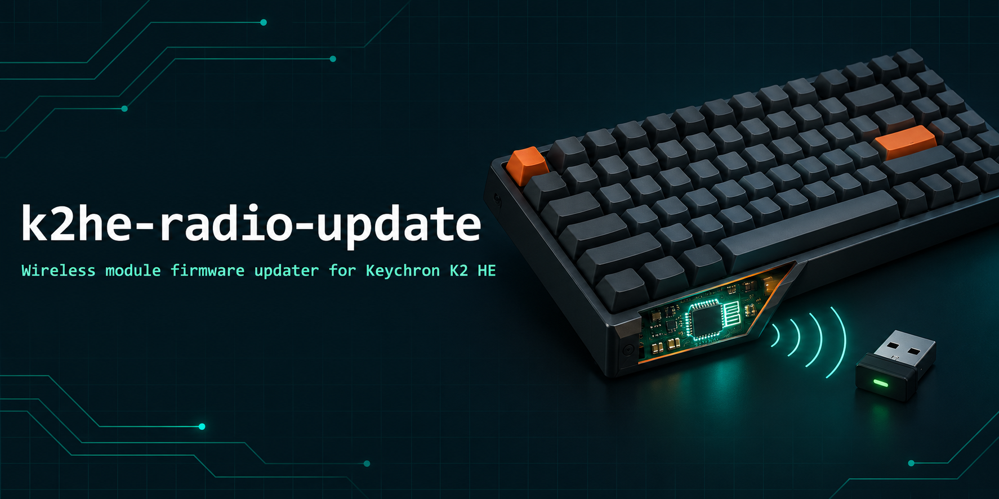
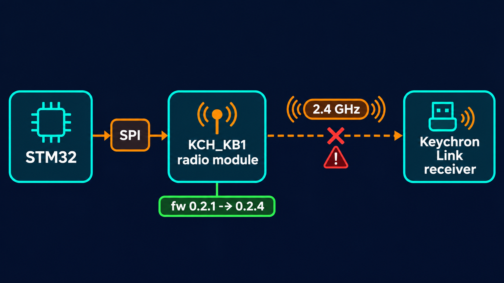

<p align="center">
  
</p>

<p align="center">
  <b>Update the Keychron K2 HE wireless module firmware over USB, without Launcher</b><br>
  Fixes 2.4 GHz when the receiver is fine but the keyboard never connects
</p>

<p align="center">
  <a href="LICENSE"></a>
  
  
  
  
</p>

<p align="center"><a href="README.md">Русский</a> · <a href="docs/protocol.md">Protocol notes</a></p>

---

> [!WARNING]
> Unofficial, not affiliated with Keychron. Use at your own risk.

## 🩺 Is this your case?

- switch in **2.4G**, Fn+4 blinks, but the keyboard never connects to the receiver;
- **Bluetooth** and **wired** work;
- reflashing the receiver, factory reset (Fn+J+Z) and other USB ports don't help.

For us the cause was old radio module firmware **KCH_KB1 0.2.1** (the 0.2.2 changelog says *"Fix the wireless connection problem."*). Keychron Launcher does not offer this update for the K2 HE, although the file is on the Launcher server. After flashing 0.2.4 the keyboard paired with the receiver at the first attempt.

<p align="center">
  
</p>

## 🚀 Quick start

```bash
git clone https://github.com/Quatrolol/k2he-radio-update
cd k2he-radio-update
pip install -r requirements.txt

python k2he_radio_update.py info               # cable connected, switch in USB position
python k2he_radio_update.py list               # module firmware on the Launcher API
python k2he_radio_update.py update --dry-run   # all checks, no flashing
python k2he_radio_update.py update             # download latest, verify, confirm, flash (~40 s)
python monitor.py                              # live keyboard transport / receiver slots
```

After updating: switch to **2.4G**, hold **Fn+4** for ~4 s, replug the receiver. Bluetooth will likely need re-pairing.

## 🛡 Safety checks

| Check | How |
|---|---|
| Switch is in USB mode | asked from the keyboard via factory command `0xAB 0x05` |
| Firmware matches the module | module model (`KCH_KB1`) must be inside the file |
| Complete download | version string must be inside the file |
| No accidental downgrade | target must be newer, otherwise `--force` |
| Data delivered | every packet is acknowledged by the module |
| Image intact | module verifies CRC32 before switching to it |

> [!NOTE]
> If flashing is interrupted, the module bootloader survives: wireless stops, wired keeps working, rerun the tool.

## 💻 Platforms

Windows 10/11: tested, no drivers or admin rights. Linux: needs `/dev/hidraw*` access (sudo or a udev rule, see the Russian README). macOS: should work via `hidapi`, untested.

Tested only on **K2 HE ANSI** (`3434:0E20`, module KCH_KB1). Tried another model? Open an issue.

## 📄 License

[MIT](LICENSE). Keychron firmware is not included; it is downloaded from Keychron servers.
