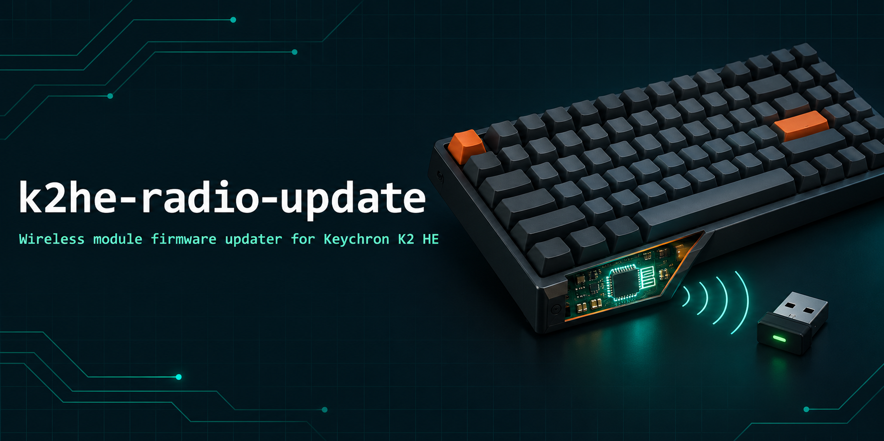
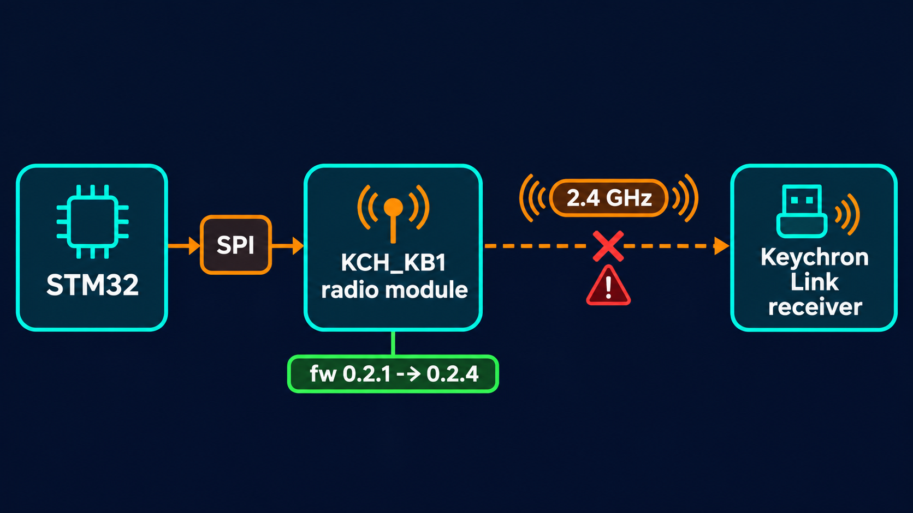

<p align="center">
  
</p>

<p align="center">
  <b>Обновление прошивки радиомодуля Keychron K2 HE через USB, без Launcher</b><br>
  Чинит 2.4 ГГц, когда приёмник исправен, а клавиатура к нему не подключается
</p>

<p align="center">
  <a href="LICENSE"></a>
  
  
  
  
</p>

<p align="center">
  <a href="#-быстрый-старт">Быстрый старт</a> ·
  <a href="#-что-проверяется-перед-прошивкой">Безопасность</a> ·
  <a href="#-монитор-связи">Монитор</a> ·
  <a href="docs/protocol.md">Протоколы</a> ·
  <a href="article/habr.md">Статья</a> ·
  <a href="README.en.md">English</a>
</p>

---

> [!WARNING]
> Неофициальный проект, с Keychron не связан. Прошивку вы делаете на свой риск.

## 🩺 Ваш случай?

- переключатель в **2.4G**, Fn+4 мигает, а клавиатура к приёмнику не подключается;
- по **Bluetooth** и **кабелю** всё работает;
- перепрошивка приёмника, сброс Fn+J+Z и смена USB-порта не помогают.

У нас причиной была старая прошивка радиомодуля внутри клавиатуры, **KCH_KB1 0.2.1**. В changelog версии 0.2.2 Keychron пишет *«Fix the wireless connection problem.»* Keychron Launcher для K2 HE эту прошивку не показывает и не обновляет, хотя файл лежит на сервере Launcher. После прошивки модуля на 0.2.4 клавиатура подключилась к приёмнику с первой попытки.

<p align="center">
  
</p>

## 🚀 Быстрый старт

```bash
git clone https://github.com/Quatrolol/k2he-radio-update
cd k2he-radio-update
pip install -r requirements.txt
```

**1. Подключите клавиатуру кабелем, переключатель режимов в положение USB.** В положениях BT и 2.4G кабель только заряжает, утилита клавиатуру не увидит.

**2. Посмотрите, что стоит сейчас:**

```console
$ python k2he_radio_update.py info
Main firmware : v1.3.3 2026-05-26-10:47:58
Transport     : USB
Radio module  : KCH_KB1  fw 0.2.1  hw 1.0.0
```

**3. Проверьте, что лежит на сервере Keychron:**

```console
$ python k2he_radio_update.py list
0.2.4    2026-07-10
0.2.3    2025-11-26
0.2.2    2026-07-09  Fix the wireless connection problem.
0.2.1    2025-01-17
0.2.0    2026-07-09
```

Даты означают загрузку файла на сервер, а не сборку прошивки.

**4. Прогоните все проверки без прошивки:**

```console
$ python k2he_radio_update.py update --dry-run
```

**5. Прошейте:**

```console
$ python k2he_radio_update.py update
...
Target        : 0.2.4 (2026-07-10)
File          : 98628 bytes, SHA-256 516ef80f9234cecb9841433ac299f2089177d75f95f519258171bb3dd4c48bb4

Flash radio module 0.2.1 -> 0.2.4? Do not unplug the cable. [y/N] y
Module bootloader (DFU) version: 1
  [#########################] 100.0%  ...
CRC32 verified, switching module to new firmware (0x66)...
Done. Radio module now reports fw 0.2.4
```

Прошивка идёт около 40 секунд. **Кабель в это время не трогайте.**

**6. Спарьте заново:** переключатель в **2.4G**, зажмите **Fn+4** на 4 секунды и переподключите приёмник. Bluetooth после обновления модуля, скорее всего, тоже придётся спарить заново.

<details>
<summary><b>Все параметры <code>update</code></b></summary>

| Параметр | Что делает |
|---|---|
| `--dry-run` | все проверки и скачивание, но без прошивки |
| `--version 0.2.2` | прошить конкретную версию |
| `--file fw.bin` | прошить локальный файл вместо скачивания |
| `--force` | разрешить перепрошивку той же или более старой версии |
| `--yes` | не спрашивать подтверждение |
| `--pid 0x0E20` | PID клавиатуры (по умолчанию K2 HE ANSI) |

</details>

## 🛡 Что проверяется перед прошивкой

| Проверка | Как |
|---|---|
| Переключатель в USB | спрашивает у самой клавиатуры заводской командой `0xAB 0x05` |
| Прошивка от этого модуля | модель, которую назвал модуль (`KCH_KB1`), должна быть внутри файла |
| Файл скачался целиком | номер версии должен быть внутри файла |
| Нет случайного даунгрейда | новая версия выше текущей, иначе нужен `--force` |
| Данные дошли | модуль подтверждает каждый пакет |
| Прошивка целая | модуль сверяет CRC32 и только потом переключается на новую версию |

> [!NOTE]
> **Если прошивка оборвалась**, загрузчик модуля остаётся на месте. Bluetooth и 2.4G перестанут работать, кабель продолжит, утилиту можно запустить ещё раз.

## 📡 Монитор связи

```console
$ python monitor.py
10:32:27 kb: 2.4G | receiver: slot0 3434:0e20 OFF | BT HID nodes: 0
10:49:35 kb: 2.4G | receiver: slot0 3434:0e20 ON  | BT HID nodes: 0
```

Раз в 0,3 секунды спрашивает у клавиатуры её режим, а у приёмника его слоты, и печатает строку при каждом изменении. Помогает проверить две вещи: видит ли прошивка все три положения переключателя и подключается ли клавиатура к приёмнику при спаривании.

Чтобы читать режим клавиатуры, нужен кабель, вставленный в положении USB. В наших тестах канал отвечал и после переключения на BT или 2.4G. Без кабеля монитор показывает только приёмник.

## 💻 Платформы

| ОС | Статус |
|---|---|
| Windows 10/11 | ✅ проверено, драйвера и права администратора не нужны |
| Linux | ⚙️ нужен доступ к `/dev/hidraw*`: `sudo` или udev-правило ниже |
| macOS | ❔ должно работать через `hidapi`, не проверяли |

```
# /etc/udev/rules.d/50-keychron.rules
KERNEL=="hidraw*", ATTRS{idVendor}=="3434", MODE="0660", TAG+="uaccess"
```

## ⌨️ Другие модели

Проверено только на **K2 HE ANSI** (`3434:0E20`) с модулем KCH_KB1. В утилите есть идентификаторы Launcher API для модулей `KCH_KB2` и `CKBT51`, а через `--pid` её можно направить на другую клавиатуру Keychron. Работать там она может, но мы этого не проверяли. Модель в файле утилита сверяет всегда. Проверили на своей модели? Откройте issue, добавим в таблицу.

## 🔬 Как это устроено

- Клавиатура отдаёт raw HID интерфейс с usage page `0xFF60`, репорты по 32 байта.
- Команда `0xAA` (`KC_WIRELESS_DFU`) пробрасывает пакеты из USB через основной STM32 по SPI в радиомодуль. Формат пакетов совпадает с `lkbt51.c` из форка QMK от Keychron.
- Прошивки модулей отдаёт Launcher API: `https://launcher.keychron.com/vapi/v2/firmware/<id>`, где `id` это VID и PID модуля одним 32-битным числом (`KCH_KB1` = `0xFF99FF99` = `4288282521`).

Все команды, форматы пакетов и идентификаторы: [docs/protocol.md](docs/protocol.md).

## 📚 Источники

- [Keychron/qmk_firmware](https://github.com/Keychron/qmk_firmware), ветка `2025q3`, `keyboards/keychron/common`: протокол raw HID, заводской тест, драйвер LKBT51.
- Keychron Launcher: API прошивок и команды приёмника.

## 📄 Лицензия

[MIT](LICENSE). Прошивки Keychron в репозиторий не входят: утилита скачивает их с сервера Keychron.
