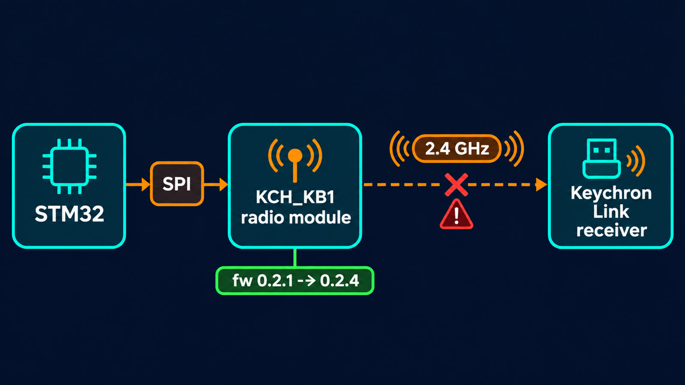
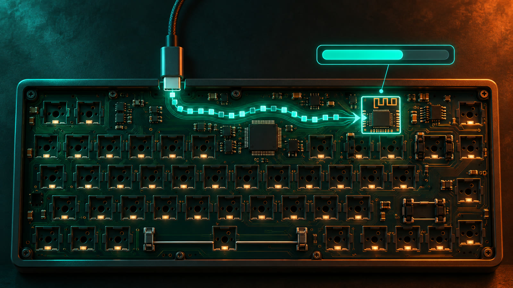

# Донгл был ни при чём: реверсим Keychron Launcher и перешиваем радиомодуль K2 HE через raw HID

У моей Keychron K2 HE перестал работать 2.4 ГГц. По всем признакам виноват приёмник, все инструкции в интернете говорят то же самое, и все они не помогают. За два часа мы с ИИ-агентом разобрали веб-приложение Keychron Launcher, поговорили с приёмником на его собственном протоколе, залезли в радиомодуль клавиатуры через сквозной канал прошивки и нашли обновление, которое Keychron выложила на сервер, но так и не показала владельцам этой модели. В конце статьи лежит утилита, которая делает всё это одной командой.


*Иллюстрация сгенерирована нейросетью.*

## Почему именно K2 HE

Требования к клавиатуре у меня выглядели скромно:

- магнитные переключатели (Hall Effect) с настраиваемой точкой срабатывания и Rapid Trigger;
- беспроводная связь без потерь по задержке, то есть 2.4 ГГц, а Bluetooth только как запасной вариант;
- раскладка 75%: F-ряд и стрелки на месте, цифрового блока нет;
- чтобы на ней было приятно и писать код, и играть.

Каждый пункт по отдельности закрывается за минуту, все вместе почти никак. Магнитные клавиатуры в основном проводные. Wooting 60HE и 80HE по играм эталон, у них опрос 8 кГц, но они проводные и дороже. Беспроводные модели обычно на механике, а беспроводные «игровые» часто сделаны из пластика, который гнётся в руках. Сверху добавляется зоопарк HE-переключателей, несовместимых между производителями.

K2 HE закрывает весь список:

| Параметр | Значение |
|---|---|
| Связь | кабель, Bluetooth, 2.4 ГГц; по 2.4 ГГц опрос 1000 Гц, как по проводу |
| Задержка по замерам RTINGS | около 5,6 мс через приёмник, 9,9 мс по Bluetooth |
| Корпус | 966 г, не прогибается, внутри несколько слоёв демпфирующей пены |
| Батарея | 4000 мА·ч, до 110 часов, но это с выключенной подсветкой |
| Рекомендованная цена | $129.99–139.99 |

iMore поставил ей 5/5, Tom's Guide 4.5/5, PC Gamer 88/100. Минусы тоже известны. Первая версия понимает только магнитные Gateron Double-Rail. С подсветкой батареи хватает примерно на 28 часов (замер APH Networks). Фирменное ПО работает через браузер и местами сыровато.

И вот у этой клавиатуры перестала работать главная фишка.

## Вводные

Симптомы:

- переключатель в положении 2.4G, приёмник Keychron Link в USB, связи нет;
- по Bluetooth клавиатура работает, но периодически отваливается;
- по кабелю работает идеально.

Разбираться я посадил Claude Code. Он работал из WSL, а к железу ходил через Windows: PowerShell для перечисления устройств и отдельный Python venv с `hidapi`, который агент сам поставил в `%TEMP%` и вызывал через `powershell.exe`. Моя роль в основном сводилась к рукам: щёлкнуть переключателем, зажать клавишу, нажать кнопку в браузере. Последнее агент сделать не может принципиально: окно выбора устройства в WebHID требует клика живого человека, и это правильно.

## Акт 1. Делаем всё по инструкции

Первый час ушёл на то, что рекомендует любой форум.

**Смотрим, что видит Windows.** У устройств с VID `3434` (Keychron) картина такая: клавиатура `3434:0E20`, приёмник `3434:D030` со странной ревизией `REV_=300` в дескрипторе. Клавиатура в этот момент работает по Bluetooth и спарена с ПК дважды, две записи K2 HE. Bluetooth-адаптер комбинированный, MediaTek вместе с Wi-Fi. Всё это выглядит подозрительно, но к 2.4 ГГц отношения не имеет.

**Обновляем прошивку клавиатуры.** Через Launcher, с 1.2.1 до 1.3.0. Пришлось поставить драйвер DFU из QMK Toolbox и перевести плату в загрузчик (`0483:DF11`, это STM32). Агент поставил фоновый скрипт, который раз в три секунды опрашивал USB и сообщал, когда плата перешла в DFU. Прошилось, 2.4 ГГц не появился.

**Спариваем заново.** Fn+4, клавиша 4 медленно мигает зелёным. Вставляем приёмник до нажатия, после нажатия, держим дольше, кладём приёмник в 20 см от клавиатуры. Ничего.

**Сбрасываем до заводских.** Fn+J+Z: подсветка радостно переливается, мои настройки стёрты, связи нет.

**Подозреваем приёмник.** По журналу Windows приёмник впервые появился в мае, а клавиатура в ноябре. Версия «донгл от другой клавиатуры» звучит логично. Агент снёс через `pnputil` все записи `3434:D030`, включая майские, Windows нашла приёмник заново. Ничего не изменилось.

Обычный пользователь на этом месте пишет в поддержку. Я попросил копнуть глубже и перешить сам приёмник.

## Акт 2. Разбираем Launcher

Keychron Launcher это Angular-приложение, которое говорит с устройствами через WebHID. Значит, весь протокол лежит в JavaScript, который браузер и так скачивает. Агент забрал `index.html`, основной бандл `main.*.js` на 3,4 МБ и ленивые чанки и начал в них искать.

Первая находка: API прошивок.

```
GET https://launcher.keychron.com/vapi/v2/product/<vendor_product_id>
GET https://launcher.keychron.com/vapi/v2/firmware/<vendor_product_id>
```

`vendor_product_id` здесь это VID и PID, склеенные в одно 32-битное число: для приёмника `0x3434D030 = 875876400`, для K2 HE ANSI `0x34340E20 = 875826720`. Ответ содержит список версий, прямые ссылки на бинарники и changelog. Авторизации нет.

Вторая находка: команды приёмника.

```js
FR_GET_PROTOCOL_VERSION = 177  // 0xB1
FR_GET_STATE            = 178  // 0xB2
FR_GET_FW_VERSION       = 179  // 0xB3
FR_DFU_OVER_VIA         = 186  // 0xBA
```

Заодно разгадалась ревизия `REV_=300`: это просто прошивка d.3.0 в нумерации Keychron. Отправляем приёмнику `0xB2`:

```
b2 01 34 34 20 0e 00 00 ...
```

После заголовка идут слоты по 5 байт: VID, PID и флаг подключения. В слоте 0 записан `3434:0E20`, то есть именно моя K2 HE. Флаг подключения равен нулю.

Здесь гипотеза про чужой донгл умерла. Приёмник знает мою клавиатуру и ждёт её. Это клавиатура к нему не приходит.

Приёмник я всё-таки перешил, раз уж протокол был на руках. Агент скачал d.3.1 (30 644 байта) через тот же API и сначала сверил модель, которую называет сам приёмник (`KCNRFDM3`), с моделью внутри файла. Потом команда `0x67` отправила приёмник в загрузчик `3434:D000`, дальше заливка, CRC32 совпал, приёмник вернулся с `REV_=301`. Клавиатура к нему по-прежнему не подключалась. Зато подозреваемый официально оправдан.

## Акт 3. Лезем в клавиатуру

С кабелем есть нюанс. Если переключатель стоит в BT или 2.4G, кабель только заряжает клавиатуру, и никакого HID по нему нет. Переводим в положение USB, и появляется raw HID интерфейс с usage page `0xFF60`: 32-байтные репорты, тот же канал, что использует VIA.

Протокол описан в исходниках. У Keychron есть публичный форк QMK (`Keychron/qmk_firmware`, ветка `2025q3`), и в `keyboards/keychron/common/keychron_raw_hid.h` лежит перечисление команд:

```c
KC_GET_PROTOCOL_VERSION = 0xA0,
KC_GET_FIRMWARE_VERSION = 0xA1,
KC_GET_SUPPORT_FEATURE  = 0xA2,
KC_MISC_CMD_GROUP       = 0xA7,
KC_KEYCHRON_RGB         = 0xA8,
KC_ANALOG_MATRIX        = 0xA9,
KC_WIRELESS_DFU         = 0xAA,
```

Рядом нашёлся заводской тест с префиксом `0xAB`. Команда `0xAB 0x05` возвращает текущий транспорт (1 = USB, 2 = Bluetooth, 4 = 2.4G), `0xAB 0x08` возвращает строку сборки. Плата назвала себя `v1.3.3 2026-05-26`, хотя Launcher только что прошил «1.3.0». Расхождение безобидное, но ровно такие мелочи и учат не верить вендорскому UI на слово.

### Гипотеза: сломан переключатель

Если контакт положения 2.4G мёртв, клавиатура в 2.4G просто не входит, и всё сходится. Проверить это можно без мультиметра. Агент написал монитор, который раз в 0,3 секунды спрашивает у клавиатуры транспорт, а у приёмника слоты, и печатает строку при любом изменении. Я прошёл переключателем по всем положениям:

```
10:32:27 kb transport=2.4G      | dongle slot0=OFF
10:32:35 kb transport=BLUETOOTH | dongle slot0=OFF
10:32:42 kb transport=USB       | dongle slot0=OFF
10:32:56 kb transport=2.4G      | dongle slot0=OFF
```

Переключатель исправен. Прошивка видит все три положения, в 2.4G корректно гасит Bluetooth, но приёмник её не видит. Повтор с Fn+4 под монитором дал то же самое.

Этот монитор оказался самым полезным инструментом всей истории. До него каждая проверка выглядела как «я нажал, вроде ничего не произошло». После него каждая проверка стала строкой лога со временем.

## Акт 4. Радиомодуль

Bluetooth и 2.4 ГГц в K2 HE обслуживает не основной STM32, а отдельный радиомодуль семейства LKBT51, подключённый к нему по SPI. Получается цепочка, и сломаться в ней могло только последнее звено.


*Где рвалась цепочка. Схема сгенерирована нейросетью.*

До модуля можно дотянуться через `KC_WIRELESS_DFU (0xAA)`: прошивка клавиатуры пересылает такие пакеты из USB прямо в SPI. Формат совпал с драйвером `lkbt51.c` из того же форка:

```
AA <type> <len> <~len> <seq> <cmd> ... <checksum16 LE>
type: 0x55 без подтверждения, 0x56 с подтверждением

0x60  информация о модуле
0x61  версия загрузчика (DFU)
0x62  начать DFU
0x63  подготовка
0x64  блок данных, 16 байт
0x65  проверка CRC32
0x66  переключение на новую прошивку
```

Длина продублирована инверсией, у каждого пакета контрольная сумма: протокол рассчитан на шумную шину и написан аккуратно. На `0x60` модуль ответил:

| Параметр | Значение |
|---|---|
| Модель | KCH_KB1 |
| Прошивка | 0.2.1 |
| Железо | 1.0.0 |

Модуль жив и отвечает, Bluetooth через него работает. Значит, железо цело, и остаётся софт.

### Прошивка, которой нет в Launcher

В бандле Launcher нашлись API-идентификаторы радиомодулей: `KCH_KB1 = 4288282521`, `CKBT51 = 4288282520`, `KCH_KB2 = 4288282519`. Это та же склейка VID и PID, только VID у модулей служебный, `0xFF99`. На странице K2 HE в Launcher раздела с прошивкой модуля нет. А API отвечает без вопросов:

```
$ python k2he_radio_update.py list      # GET /vapi/v2/firmware/4288282521
0.2.4    2026-07-10
0.2.3    2025-11-26
0.2.2    2026-07-09  Fix the wireless connection problem.
0.2.1    2025-01-17
0.2.0    2026-07-09
```

Даты здесь означают загрузку на сервер, а не сборку.

У меня стоит 0.2.1. В следующей версии Keychron прямым текстом пишет «Fix the wireless connection problem.» Обновление существует, лежит на официальном сервере, и владелец K2 HE не может получить его штатными средствами.

В бинарниках есть строки сборки: у 0.2.1 `Nov 9 2024`, у 0.2.4 `Nov 25 2025`. Год разницы.

## Перепрошивка модуля

Этот шаг опаснее всего остального. Если заливка оборвётся, модуль останется без рабочей прошивки, и пропадут оба радио. Кабель продолжит работать (за USB отвечает STM32), загрузчик модуля тоже должен уцелеть, но проверять это на практике не хотелось. Поэтому агент остановился и спросил разрешения, а до этого собрал всё, что можно проверить заранее:

1. Командой `0xAB 0x05` убедился, что клавиатура в режиме USB и модуль не занят радиосвязью.
2. Спросил у загрузчика модуля его версию (`0x61`, ответ: DFU v1).
3. Проверил, что строка модели `KCH_KB1`, которую назвал модуль, есть внутри файла.


*Иллюстрация сгенерирована нейросетью. На самом деле пакеты идут через основной STM32, а он передаёт их модулю по SPI.*

Дальше `0x62`, `0x63` и 98 628 байт блоками по 16, это 6165 пакетов `0x64`. Каждый ждёт подтверждения, при молчании до пяти повторов. Ядро цикла:

```python
for off in range(0, len(data), 16):
    w = list(data[off:off + 16])
    n = len(w) + 5
    pkt = [0xAA, 0x56, n, (~n) & 0xFF, seq, 0x64, 0, seq] + w
    s = 0x64 + seq + sum(w)
    pkt += [s & 0xFF, (s >> 8) & 0xFF]
    seq = 0 if seq >= 255 else seq + 1
```

Последний шаг, `0x65`, отправляет CRC32 образа, и тут есть деталь, на которой легко споткнуться. Модуль ждёт CRC32 **без финального XOR**, то есть `zlib.crc32(data) ^ 0xFFFFFFFF`. А у файла 0.2.4 обычный `zlib.crc32` целиком равен `0xFFFFFFFF`. Похоже, контрольная сумма вшита в конец образа, и для корректного файла в модуль уходит ноль. Кто знает, как это устроено у LKBT51 на самом деле, напишите в комментариях.

Заливка заняла около 40 секунд. После `0x66` модуль перезапустился и на `0x60` ответил: 0.2.4.

## Результат

Переключатель в 2.4G, Fn+4, переподключаем приёмник, смотрим в монитор:

```
10:49:35 kb transport=2.4G | dongle slot0: vid=3434 pid=0e20 status=ON
```

Пять опросов подряд ON, клавиатура печатает по 2.4 ГГц.

| Компонент | Было | Стало |
|---|---|---|
| Основная прошивка (STM32) | 1.2.1 | 1.3.0 (сама плата говорит 1.3.3) |
| Радиомодуль KCH_KB1 | 0.2.1 | **0.2.4**, это и было лечение |
| Приёмник Keychron Link | d.3.0 | d.3.1 |

Из трёх прошивок проблему решала одна, и именно её Launcher для K2 HE не показывает.

## Утилита

Всё, что агент писал по ходу, я собрал в репозиторий [k2he-radio-update](https://github.com/Quatrolol/k2he-radio-update):

```bash
pip install hidapi
python k2he_radio_update.py info               # прошивки и текущий режим
python k2he_radio_update.py list               # что лежит на сервере Keychron
python k2he_radio_update.py update --dry-run   # все проверки без прошивки
python k2he_radio_update.py update             # скачать и прошить модуль
python monitor.py                              # режим клавиатуры и слоты приёмника вживую
```

Перед прошивкой утилита проверяет, что переключатель в USB, что модель модуля совпадает с моделью в файле и что версия новее текущей. Каждый пакет подтверждается, CRC32 модуль сверяет сам до переключения на новую прошивку. Протоколы описаны в `docs/protocol.md`. Проверено только на K2 HE ANSI с модулем KCH_KB1. Если у вас другая HE-модель Keychron с похожими симптомами, сначала запустите `info` и посмотрите версию модуля.

## Что я из этого вынес

**Делите цепочку на звенья и проверяйте каждое отдельно.** «Не работает 2.4 ГГц» звучит как одна проблема, а на деле это пять компонентов: переключатель, STM32, SPI, радиомодуль и приёмник. Каждое звено проверяется своим вопросом, ответ «да» или «нет», и через пару часов неисправность найдена.

**Сначала наблюдаемость, потом гипотезы.** Пока монитора не было, мы гадали. Когда он появился, каждая проверка стала строкой лога. Несколько десятков строк на Python окупились с первого запуска.

**Вендорскому UI верить можно, но проверять стоит.** Launcher показывал не ту версию платы и не показывал существующее обновление модуля. Его же собственный API и бандл рассказали больше, чем интерфейс.

**ИИ-агент сильнее всего там, где нужно много читать.** Минифицированный бандл на 3,4 МБ, форк QMK, логи монитора: агент читал всё это быстрее меня и собирал протокол из кусков. Половину времени он, правда, потратил на те же стандартные советы, что дал бы любой форум, а сдвинулся с места, когда начал читать код. Перед каждой заливкой он сверял модель устройства с моделью в файле, а перед рискованной спрашивал разрешение. С такими правилами доверить ему железо оказалось не страшно.

**Про Keychron.** Железо отличное, сборка, звук и задержка по 2.4 ГГц на уровне провода. Но исправление связи лежит на их же сервере и до владельцев этой модели не доходит. Я бы поставил K2 HE 8 из 10: девять за железо, минус балл за софт.

## Если повторяете

Прошивка не от той модели может превратить клавиатуру в кирпич. Модуль с оборванной заливкой остаётся без радио. Не выдёргивайте кабель во время прошивки, сверяйте модель, начните с `--dry-run`. Если сомневаетесь, пишите в поддержку Keychron и прикладывайте версии всех трёх прошивок: основной, модуля и приёмника. Утилита их покажет.
